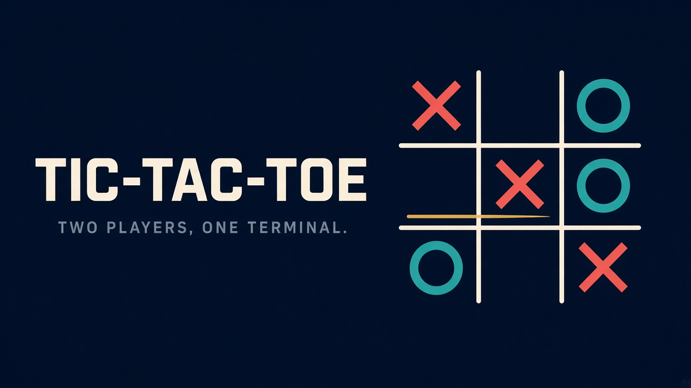

# testGit2

Two Python apps: a terminal tic-tac-toe game, and a Streamlit dashboard for the Titanic passenger data.

## Tic-Tac-Toe



<p>
  
  
  
  
  
</p>

Two-player tic-tac-toe in the terminal. No dependencies beyond Python 3.

### Run

```bash
python tictactoe.py
```

### How to play


- X goes first. Each player picks a free square by its number.
- Three in a row — across, down, or diagonal — wins.
- After 9 moves with no winner, the game is a draw.
- At the end, `y` plays again and `n` quits.

## Titanic dashboard

Interactive survival view of the 891-passenger Titanic dataset in `data/titanic.csv`. The sidebar filters by sex, class, embarkation port, and age. Metrics, bar charts, and the passenger table follow the filter.

Needs `streamlit`, `pandas`, and `altair` (`altair` is installed with Streamlit).

```bash
python -m streamlit run titanic_dashboard.py
```

Streamlit prints the local URL when it starts. The default port is 8501.
